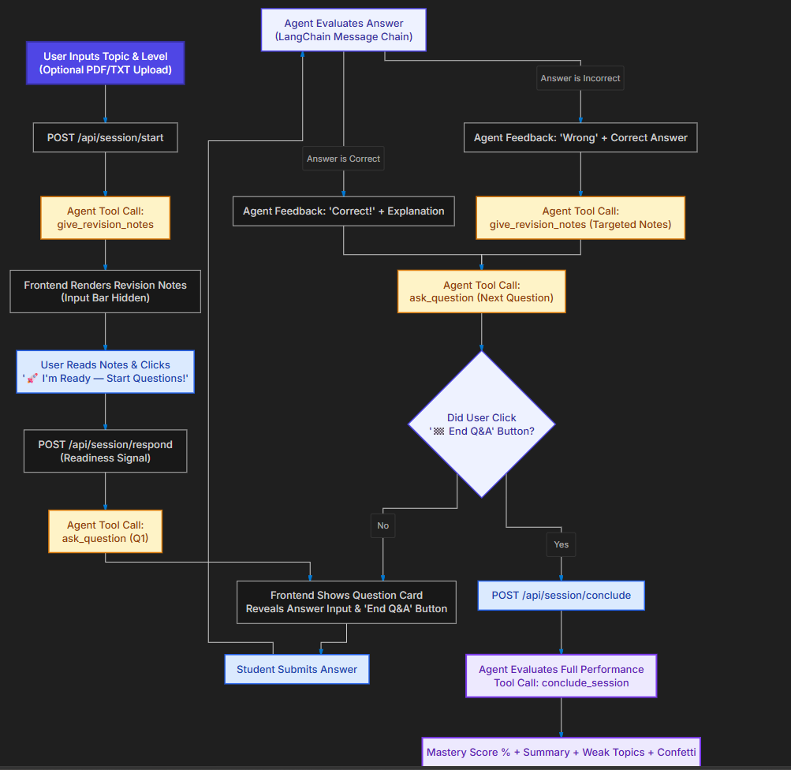

# 🎓 Revision Agent — AI-Powered Revision Tutor

An AI-powered revision assistant that helps students **revise concepts, test their knowledge, learn from mistakes, and track their progress** through interactive question-and-answer sessions.

## ✨ Features

- 📚 **AI-Generated Notes:** Generate revision notes for any topic.
- 🧠 **Interactive Quizzes:** Test understanding through AI-generated questions.
- 🎯 **Targeted Revision:** Get additional explanations and notes for incorrect answers.
- 💬 **Doubt Resolution:** Ask follow-up questions during revision.
- 📊 **Performance Evaluation:** Receive a mastery estimate, learning summary, and weak topics.
- 🤖 **AI Agent:** Uses LangChain tool calling to coordinate the tutoring workflow.

## 🛠️ Tech Stack

- **Backend:** Python, FastAPI, Uvicorn
- **AI:** LangChain, Groq API
- **Frontend:** HTML, CSS, JavaScript
- **Environment Management:** uv

## 🔄 How It Works

## 🔄 How It Works

Revision Agent follows a structured workflow to make learning interactive and personalized.

1. **Choose a topic:** Select a topic and difficulty level, optionally uploading study material.
2. **Generate revision notes:** The AI agent prepares notes for the selected topic.
3. **Start the Q&A session:** The agent asks questions to test your understanding.
4. **Evaluate answers:** Correct answers receive feedback; incorrect answers trigger explanations and targeted revision notes.
5. **Track performance:** End the session to receive a mastery score, summary, and weak topics to revisit.

### Workflow Diagram

<p align="center">
  
</p>

## 🚀 Installation and Setup

### Prerequisites

- Python 3.13+
- Git
- [uv](https://docs.astral.sh/uv/)
- [Groq API key](https://console.groq.com/)

### 1. Clone the repository

```bash
git clone https://github.com/Shams-Iqbal04/Revision_Agent.git
cd Revision_Agent
```

### 2. Install dependencies

```bash
uv sync
```

### 3. Configure environment variables

Create a `.env` file in the project root:

```env
GROQ_API_KEY=your_groq_api_key
GROQ_MODEL=openai/gpt-oss-120b
```

Replace the placeholder with your own API key.

### 4. Run the application

```bash
uv run python run.py
```

## 👨‍💻 Author

**Shams Iqbal**
---

⭐ If you find this project useful, consider giving the repository a star!
